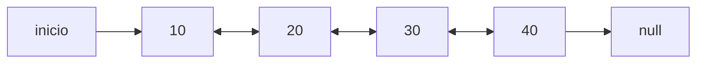

[LinkedList_vs_ArrayList.pptx](https://github.com/user-attachments/files/35441029/LinkedList_vs_ArrayList.pptx)


# 📖 Investigación: ArrayList y LinkedList en Java


## 📑 Contenido

1. [Contexto](#-contexto)
2. [ArrayList](#-arraylist)
3. [LinkedList](#-linkedlist)
4. [Comparación directa](#️-comparación-directa)
5. [Un detalle importante en la práctica](#-un-detalle-importante-en-la-práctica)
6. [¿Cuál usar?](#-cuál-usar)


---

## 🧭 Contexto

Ambas clases pertenecen al **Java Collections Framework** (paquete `java.util`) e implementan la interfaz `List`. Esto significa que:

- Mantienen el **orden de inserción**.
- Permiten **elementos duplicados** y valores `null`.
- Se accede a los elementos por **posición (índice)**.
- **No son seguras para hilos** (no están sincronizadas).

La diferencia está en **cómo guardan los datos internamente**, y de ahí salen casi todas las diferencias de velocidad, memoria y casos de uso.

---

## 🟦 ArrayList

### Cómo funciona

Usa un **arreglo dinámico** (`Object[]`) por dentro. Los elementos quedan **contiguos en memoria**, uno junto al otro.

```
índice:   0     1     2     3
        [ 10 ][ 20 ][ 30 ][ 40 ]
```

- Cuando el arreglo se llena, Java crea uno nuevo **aproximadamente 1,5 veces más grande** y copia los datos.
- La capacidad inicial por defecto es **10** (se reserva al agregar el primer elemento).
- Implementa la interfaz marcadora `RandomAccess`, que indica que el acceso por índice es rápido.

### Complejidad de las operaciones

| Operación | Complejidad | Por qué |
|---|:---:|---|
| `get(i)` / `set(i, x)` | O(1) | Acceso directo a la posición del arreglo |
| `add(x)` al final | O(1) amortizado | Solo cuesta O(n) cuando hay que redimensionar |
| `add(0, x)` / `add(i, x)` | O(n) | Hay que desplazar los elementos siguientes |
| `remove(i)` | O(n) | Hay que desplazar los elementos hacia atrás |
| `contains(x)` | O(n) | Recorre la lista comparando |

### Ventajas y desventajas

| ✅ Ventajas | ❌ Desventajas |
|---|---|
| Acceso por índice muy rápido | Insertar o eliminar al inicio o en medio es costoso |
| Menor consumo de memoria (solo guarda referencias) | Redimensionar implica copiar todo el arreglo |
| Recorrido rápido: aprovecha la caché del procesador | Puede quedar espacio reservado sin usar |

---

## 🟧 LinkedList

### Cómo funciona

Es una **lista doblemente enlazada**. Cada elemento vive en un **nodo** que guarda tres cosas: el dato, una referencia al nodo **anterior** y una referencia al nodo **siguiente**. La lista conserva referencias al primer y al último nodo.



Además de `List`, implementa **`Deque`**, así que también sirve como cola, pila o cola doble (`addFirst`, `addLast`, `removeFirst`, `poll`, `push`, `pop`, etc.).

### Complejidad de las operaciones

| Operación | Complejidad | Por qué |
|---|:---:|---|
| `addFirst(x)` / `addLast(x)` | O(1) | Solo se cambian referencias |
| `removeFirst()` / `removeLast()` | O(1) | Igual |
| `get(i)` | O(n) | Recorre nodos desde el inicio o el final (el más cercano) |
| `add(i, x)` / `remove(i)` | O(n) | Enlazar es O(1), pero **llegar** a la posición cuesta O(n) |
| `contains(x)` | O(n) | Recorre la lista |

> 💡 Con un `ListIterator` ya posicionado, insertar o eliminar en ese punto sí es O(1).

### Ventajas y desventajas

| ✅ Ventajas | ❌ Desventajas |
|---|---|
| Insertar y eliminar en los extremos es muy rápido | Acceso por índice lento |
| No necesita redimensionar ni copiar bloques de datos | Mayor consumo de memoria: cada nodo es un objeto con dos referencias extra |
| Útil como cola, pila o deque | Peor uso de la caché, porque los nodos pueden estar dispersos |

---

## ⚖️ Comparación directa

| Aspecto | ArrayList | LinkedList |
|---|---|---|
| Estructura interna | Arreglo dinámico | Lista doblemente enlazada |
| Acceso por índice | O(1) | O(n) |
| Insertar/eliminar al inicio | O(n) | O(1) |
| Insertar/eliminar al final | O(1) amortizado | O(1) |
| Insertar/eliminar en medio | O(n) | O(n) (O(1) con iterador posicionado) |
| Búsqueda | O(n) | O(n) |
| Memoria | Menor | Mayor |
| Caché del procesador | Muy buen aprovechamiento | Poco aprovechamiento |
| Interfaces | `List`, `RandomAccess` | `List`, `Deque` |

---

## 🔍 Un detalle importante en la práctica

Aunque en teoría `LinkedList` gana al insertar o eliminar en medio, **en la práctica `ArrayList` suele ser igual de rápida o más**, incluso en esas operaciones.

Esto se debe a que copiar un bloque contiguo de memoria (lo que hace `ArrayList` con `System.arraycopy`) es muy eficiente, mientras que recorrer nodos dispersos en memoria es lento.

Por eso, muchos desarrolladores consideran que `LinkedList` rara vez es la mejor opción. Si lo que necesitas es una **cola o pila**, `ArrayDeque` suele ser más rápida y ligera que `LinkedList`.

---

## 🎯 ¿Cuál usar?

**Usa `ArrayList` cuando:**
- Haces muchas lecturas por índice.
- Agregas principalmente al final.
- Importa el consumo de memoria.
- No tienes un motivo específico para otra cosa (es la opción por defecto).

**Usa `LinkedList` cuando:**
- Haces muchas inserciones o eliminaciones al inicio.
- Necesitas las operaciones de `Deque` y no usas `ArrayDeque`.
- Recorres con un iterador y modificas la lista constantemente en esa posición.

---


