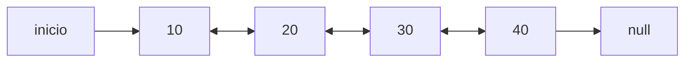

<div align="center">

# 🔗 LinkedList y comparación ArrayList vs. LinkedList

## 📑 Contenido

- [🧩 Problema](#-problema)
- [🎯 Objetivo](#-objetivo)
- [📚 Conceptos ALP utilizados](#-conceptos-alp-utilizados)
- [🛠️ Procedimiento](#️-procedimiento)
- [🧰 Herramientas](#-herramientas)
- [👥 Integrantes](#-integrantes)
- [✅ Conclusiones](#-conclusiones)

---

## 🧩 Problema

`ArrayList` y `LinkedList` implementan la misma interfaz `List`, así que **se usan casi igual**, pero por dentro funcionan muy distinto. Elegir la equivocada puede volver lento un programa que maneja muchos datos.

> ❓ **Pregunta guía:** ¿en qué operaciones gana `ArrayList` y en cuáles gana `LinkedList`?

## 🎯 Objetivo

**General:** entender cómo funciona `LinkedList` y compararla con `ArrayList` para saber cuándo usar cada una.

**Específicos:**
- 🔹 Explicar la lista enlazada (nodos y referencias).
- 🔹 Implementar nuestra propia lista enlazada simple.
- 🔹 Medir tiempos de inserción, eliminación, acceso y búsqueda.
- 🔹 Relacionar los resultados con la complejidad Big O.

## 📚 Conceptos ALP utilizados

| Concepto | Dónde lo usamos |
|---|---|
| Estructuras de datos | `ArrayList`, `LinkedList` |
| Nodos y referencias | Lista enlazada propia (`Nodo`) |
| Arreglos dinámicos | Funcionamiento interno de `ArrayList` |
| Ciclos (`for`, `while`) | Llenado y recorrido de listas |
| Condicionales | Validar índices y listas vacías |
| Métodos | Una función por cada prueba |
| POO | Clases, objetos e interfaz `List` |
| Complejidad (Big O) | Análisis teórico vs. práctico |
| Medición de tiempo | `System.nanoTime()` |

### 🧠 Cómo se ve por dentro

**ArrayList:** elementos juntos en memoria (un arreglo).

```
índice:   0     1     2     3
        [ 10 ][ 20 ][ 30 ][ 40 ]
```

**LinkedList:** cada nodo apunta al siguiente (y al anterior).



### ⚖️ Comparación teórica

| Operación | ArrayList | LinkedList |
|---|:---:|:---:|
| Acceso por índice | ✅ O(1) | ❌ O(n) |
| Agregar al final | ✅ O(1)* | ✅ O(1) |
| Insertar al inicio | ❌ O(n) | ✅ O(1) |
| Eliminar al inicio | ❌ O(n) | ✅ O(1) |
| Insertar en medio | ❌ O(n) | ⚠️ O(n)** |
| Buscar elemento | ⚠️ O(n) | ⚠️ O(n) |
| Memoria | ✅ Menor | ❌ Mayor |

\* Amortizado (a veces redimensiona el arreglo).
\** Enlazar es O(1), pero llegar a la posición cuesta O(n).

## 🛠️ Procedimiento

1. 🔎 **Investigar** el funcionamiento interno de ambas estructuras.
2. 🧱 **Implementar** una lista enlazada simple propia para entender los nodos.
3. ⏱️ **Medir** cada operación con distintos tamaños (1 000, 10 000, 50 000 elementos).
4. 🔁 **Repetir** varias veces y promediar, para evitar resultados engañosos.
5. 📈 **Comparar** los tiempos con la teoría y sacar conclusiones.

<details>
<summary>🧱 <b>Ver implementación de lista enlazada propia</b></summary>

```java
public class ListaEnlazada {

    private static class Nodo {
        int dato;
        Nodo siguiente;

        Nodo(int dato) {
            this.dato = dato;
        }
    }

    private Nodo cabeza;
    private int tamano;

    public void agregarAlInicio(int dato) {
        Nodo nuevo = new Nodo(dato);
        nuevo.siguiente = cabeza;
        cabeza = nuevo;
        tamano++;
    }

    public void agregarAlFinal(int dato) {
        Nodo nuevo = new Nodo(dato);
        if (cabeza == null) {
            cabeza = nuevo;
        } else {
            Nodo actual = cabeza;
            while (actual.siguiente != null) {
                actual = actual.siguiente;
            }
            actual.siguiente = nuevo;
        }
        tamano++;
    }

    public boolean eliminarAlInicio() {
        if (cabeza == null) return false;
        cabeza = cabeza.siguiente;
        tamano--;
        return true;
    }

    public boolean buscar(int dato) {
        Nodo actual = cabeza;
        while (actual != null) {
            if (actual.dato == dato) return true;
            actual = actual.siguiente;
        }
        return false;
    }

    public int tamano() {
        return tamano;
    }
}
```

</details>

<details>
<summary>⏱️ <b>Ver programa de comparación (benchmark)</b></summary>

```java
import java.util.ArrayList;
import java.util.LinkedList;
import java.util.List;

public class Comparacion {

    static final int REPETICIONES = 5;

    static long insertarInicio(List<Integer> lista, int n) {
        long t = System.nanoTime();
        for (int i = 0; i < n; i++) lista.add(0, i);
        return System.nanoTime() - t;
    }

    static long insertarFinal(List<Integer> lista, int n) {
        long t = System.nanoTime();
        for (int i = 0; i < n; i++) lista.add(i);
        return System.nanoTime() - t;
    }

    static long accesoPorIndice(List<Integer> lista, int n) {
        long t = System.nanoTime();
        for (int i = 0; i < n; i++) lista.get(i);
        return System.nanoTime() - t;
    }

    static long eliminarInicio(List<Integer> lista, int n) {
        long t = System.nanoTime();
        for (int i = 0; i < n; i++) lista.remove(0);
        return System.nanoTime() - t;
    }

    static List<Integer> llenar(List<Integer> lista, int n) {
        for (int i = 0; i < n; i++) lista.add(i);
        return lista;
    }

    static double promedioMs(long[] tiempos) {
        long suma = 0;
        for (long x : tiempos) suma += x;
        return suma / (double) tiempos.length / 1_000_000.0;
    }

    public static void main(String[] args) {
        int n = 50_000;

        long[][] a = new long[4][REPETICIONES]; // ArrayList
        long[][] l = new long[4][REPETICIONES]; // LinkedList

        for (int r = 0; r < REPETICIONES; r++) {
            a[0][r] = insertarFinal(new ArrayList<>(), n);
            l[0][r] = insertarFinal(new LinkedList<>(), n);

            a[1][r] = insertarInicio(new ArrayList<>(), n);
            l[1][r] = insertarInicio(new LinkedList<>(), n);

            a[2][r] = accesoPorIndice(llenar(new ArrayList<>(), n), n);
            l[2][r] = accesoPorIndice(llenar(new LinkedList<>(), n), n);

            a[3][r] = eliminarInicio(llenar(new ArrayList<>(), n), n);
            l[3][r] = eliminarInicio(llenar(new LinkedList<>(), n), n);
        }

        String[] nombres = {"Insertar al final", "Insertar al inicio",
                            "Acceso por índice", "Eliminar al inicio"};

        System.out.printf("%-20s %14s %14s%n", "Operación", "ArrayList(ms)", "LinkedList(ms)");
        for (int i = 0; i < nombres.length; i++) {
            System.out.printf("%-20s %14.2f %14.2f%n",
                    nombres[i], promedioMs(a[i]), promedioMs(l[i]));
        }
    }
}
```

**Ejecutar:**

```bash
javac Comparacion.java
java Comparacion
```

</details>

## 🧰 Herramientas

| Herramienta | Uso |
|---|---|
| ☕ Java (JDK 17+) | Lenguaje de programación |
| 💻 IntelliJ IDEA / NetBeans / VS Code | Editor / IDE |
| 🌿 Git y GitHub | Control de versiones |
| 📝 Markdown | Documentación |


## 👥 Integrantes

| 👤 Nombre | 
|---|---|
| Betancourt Steven  | 
| Ogonaga Isaac  | 
| Terán Julio  | 

## ✅ Conclusiones

1. 📌 **No hay una estructura mejor en todo:** depende de las operaciones que más se hagan.
2. 🚀 `ArrayList` conviene cuando se necesita **acceder rápido por índice** y se agregan datos al final.
3. 🔁 `LinkedList` conviene con **muchas inserciones y eliminaciones al inicio**, o para usarla como cola o pila.
4. 💾 `ArrayList` usa menos memoria; por eso suele ser la opción por defecto.
5. 📐 Medir tiempos y conocer Big O permite tomar mejores decisiones de diseño.

---

<div align="center">

